# POLVO Y GLORIA — historical open-road racing game (1894-1970)

> **Game in development.** POLVO Y GLORIA is not finished and is not on sale. What is described here are design goals that may change or be left out; the images are work in progress, and the AI-generated ones do not show what the game looks like. *Updated on 25 November 2026.*

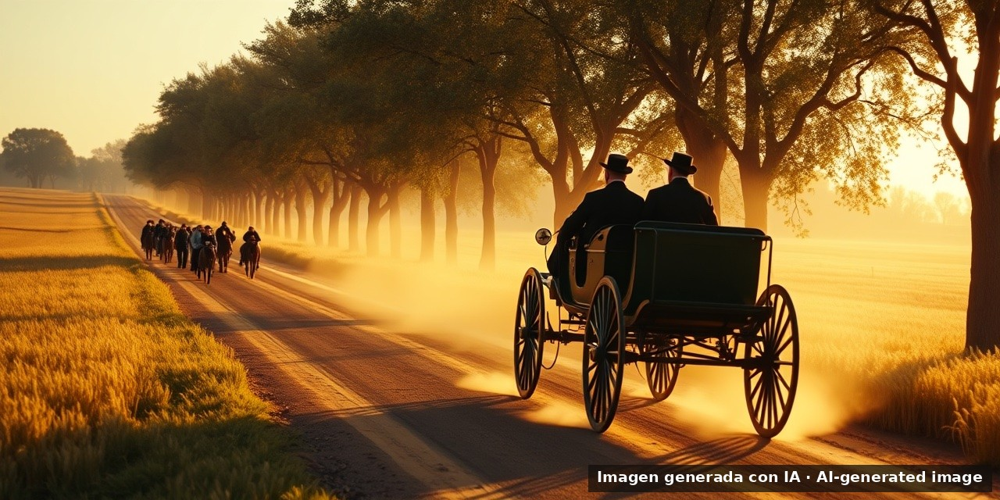

  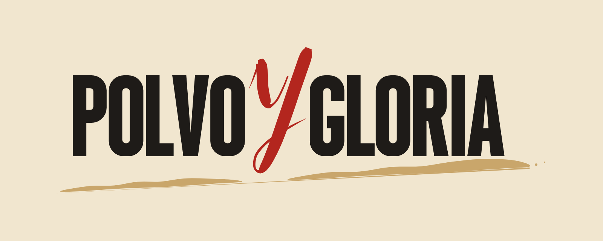

<b>Historical open-road racing, from 1894 to 1970.</b>

<a href="README.md">Español</a> · <b>English</b> · Web: <a href="https://lv-webstudio.github.io/polvo-y-gloria-escaparate/en/">lv-webstudio.github.io/polvo-y-gloria-escaparate/en</a>

---

## Concept

Before race circuits, races were run on the public road: between villages, over macadam and cobblestones, with a mechanic on board and a cloud of dust behind. **POLVO Y GLORIA** puts you in those cars, from the first "horseless carriages" of 1894, with no throttle and three gears, to the last great road marathons of 1970. Here the winner is not the one who goes fastest, but the one who can get the machine to the finish: not stalling on the hill, choosing the right gear, looking after the wheels and not running out of water.

It is a game by **[Shania Webstudio](https://shaniawebstudio.com)** (Granada), made with the **Godot** engine. The goal is high: we are aiming for a premium, hyperrealistic visual finish within a focused scope, with few races and few cars, but a great deal of depth.

## The eras and progression

| Era | Name (provisional) | Years |
|---|---|---|
| **I** | The horseless carriages | 1894-1903 |
| **II** | The circuit monsters | 1904-1914 |
| **III** | The giants of the interwar years | 1919-1940 |
| **IV** | The golden age of the road | 1947-1957 |
| **V** | The last open roads (expansion) | 1958-1970 |

The first four eras make up the game; the fifth is planned as an expansion. Work is currently on era I.

**How you advance** (approved design, not yet in the prototype):
- You start with a car from 1894, No. 15, and little money, in 1894 gold francs. You earn money by driving.
- Cars are divided into classes as in 1894: light petrol, touring petrol and steam. Each class has its own podium and prizes, besides the overall classification. Steam cars come after the petrol ones.
- With what you earn you buy other cars of the period. In free race you can drive all of them from the start.
- The Grand Contest chains the three real stages of Paris-Rouen, with the 1894 prizes.
- Each championship gives you a legendary car.
- Rivals have four levels: Amateur, Contestant, Builder and Master.

## The first race: Paris-Rouen, 1894

On 22 July 1894 the horseless carriage contest from Paris to Rouen was run: 126 km, 102 entrants, 21 cars in the final and 17 arrivals at Rouen. The rules required an average of 12.5 km/h.

In the game, the race is run in three stages of the real road:

| Stage | Route | Length | Maximum gradient |
|---|---|---|---|
| 1 | Triel → Vaux → Meulan | 10.1 km | 12.8 % |
| 2 | Rosny → Rolleboise → Bonnières | 7.3 km | 10.5 % |
| 3 | Gaillon → Sainte-Barbe → Vieux-Villez → Heudebouville → Saint-Pierre-du-Vauvray | 13.2 km | 15.0 % |

**The other races of era I** (in the development version you can already pick them from the menu, in testing):

| Race | Stage | Length | Maximum gradient |
|---|---|---|---|
| Paris-Bordeaux 1895 | Versailles → Châteaufort → Saint-Rémy-lès-Chevreuse | 16.0 km | 15.0 % |
| Paris-Marseille 1896 | Champs-sur-Yonne → Vincelles → Cravant | 11.1 km | 10.3 % |
| Marseille-Nice-La Turbie 1897 | Grande Corniche: col de Villefranche → col d'Èze → La Turbie | 9.5 km | 15.0 % |
| Paris-Dieppe 1897 | Éragny → Pontoise → Ennery | 7.2 km | 15.0 % |
| Paris-Trouville 1897 | Descent of La Rivière-Thibouville | 13.4 km | 14.0 % |
| Tour of 1899 | Orgeval → Chambourcy → Saint-Germain (route des Quarante-Sous) | 6.2 km | 10.5 % |
| Paris-Berlin 1901 | Douzy → Sachy → Carignan | 11.0 km | 6.7 % |
| Paris-Madrid 1903 | Châteaudun → Cloyes | 9.1 km | 8.4 % |

Road gradients are capped at 15 %, because the 10 m terrain puts embankments into hillside roads.

## The cars of 1894

**Your car: No. 15.**
- Two-seater with a front engine, no throttle: the engine runs at a fixed speed.
- Three gears, a chain to the rear axle and a tiller for steering.
- Iron tyre or solid rubber tyre, your choice.
- Its weight and power in the simulation are provisional, taken from period sources, and will be adjusted if better data appears.

**The 19 rivals of Paris-Rouen.** Each one is modelled from the engravings and photos of the event, with the number it carried in 1894:
- No. 4, steam tractor with victoria;
- two-seater (No. 27), break (No. 31), fiacre (No. 30), phaéton (No. 65) and two vis-à-vis (No. 28 and No. 42), all on a tube frame with a rear engine;
- dos-à-dos (No. 13), new-type four-seater (No. 14), two-seater with steering wheel (No. 24), four-seater with awning and fringes (No. 64) and four-seater with a front engine (No. 7);
- victoria with a rear engine (No. 85);
- closed 6-seat omnibus (No. 18), delivery van (No. 19), light car heated by petroleum (No. 44) and 9-seat breack (No. 60);
- steam break-omnibus (No. 10);
- tricycle (No. 61).

The cars are inspired by those of the event, with no brand names. In the development version, all 19 wait on the starting grid; making them drive the stage is the next step.

## Driving and simulation

- **Own simulation** of each car: fixed-speed engine, slipping clutch, three gears, reverser (forward, neutral and reverse), tiller and brake.
- **Road surface:** cobblestone, good macadam and bad track, with their potholes. Each one can be felt in the grip and in the jolts.
- **Starting:** the engine is started with a crank. If it pulls away in the wrong gear or too abruptly, it jerks and can blow out the burner, which is relit with the car stopped.
- **Breakdowns:** wheels that break and are changed along the way, leaf springs that give way, and the engine that stalls if the clutch is not looked after.
- **Controls:** keyboard or gamepad. The menu has a guide, "How to drive".

## Real maps: the Rolleboise hill

The stages come from the open data of the IGN of France:
- the real terrain at 10 m;
- the axis of the old national road, which today carries another number;
- the état-major maps of 1820-1866, which give the villages, the water and the forest of the time.

The generator turns the road of 2026 into the road of 1894.

In stage 2, between Rosny and Bonnières, the village streets of Rolleboise and Bonnières are **cobblestone**. The Rolleboise hill, with ramps of 5 to 7 %, is **macadam**. The type of surface is deduced from the practice of the time, not documented stage by stage.

## Historical rigour

- Cars, roads and events documented with period sources whenever possible: magazines and newspapers of 1894, engravings and photos of the event, and the état-major maps.
- The cars are **inspired by** real models, with their own names and details and no brands. The workshop only has the parts that existed in each era.
- What the sources do not say is marked as an estimate, in the data and on the prototype screen (for example, the grip of the rubber tyre).
- **The races of remembrance:** some historical races ended in tragedy. They open when you complete the game and are treated with respect: the real accident is never recreated, there is no celebration or rewards that can be sold, and a documentary screen separates the facts from the fiction.

## Technology

- **Godot 4.7** (.NET). The car simulation is in C# and the game is in GDScript.
- **Blender by code:** each car is built with a Python script (frame, wheels, leaf springs, lamps, seats), with materials, levels of detail and collisions.
- **Maps by code:** a Python generator reads the IGN data and produces the terrain, the terrain types and the axis of each stage.
- **Automated tests:** on every change they check that the simulation gives the same result inside and outside Godot, as well as the menus, the controls, the road surface and the breakdowns.

## Status and roadmap

**In development, prototype.** You can already drive the 1894 car on the real stages, with its physics, its gears and its breakdowns. Graphics, terrain, sound and content are provisional and will change: there is still no vegetation or villages on the stages. There is no release date.

What comes next, in this order and **with no promised dates**:

1. Rivals that drive the stage with the same physics as you, set off every 30 seconds as in 1894 and later overtake.
2. Vegetation, villages and sky on the stages.
3. The career: money, garage, the Grand Contest and the legendary cars.
4. The Museum: see the cars in high quality, open them, start them, hear them and get in, with their photo and their history.
5. The cab and the three handling levels.
6. Eras II to IV and, after that, the era V expansion.

## In preparation

- **Wildlife of the Seine valley.** The first stage, in the Seine valley in July 1894, will have the animals of the area and the period: Normande cows, draught and saddle horses, Merino sheep, Houdan hens and river birds such as the grey heron and the mallard.
- **The 1894 rivals, in concept.** Concepts of the rival vehicles, inspired by the 1894 Paris-Rouen race: petrol and steam vehicles, with a canopy, with a folding hood or open, and a tricycle.
- **The interwar years.** Another period is already being prepared, the 1920s and 1930s, with its cars and its people: sports two-seaters, open tourers and the everyday clothes of the time.

## Gallery

| | |
|---|---|
| 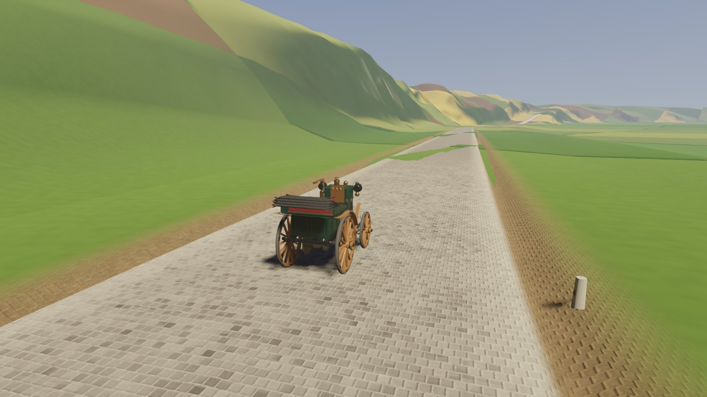 | 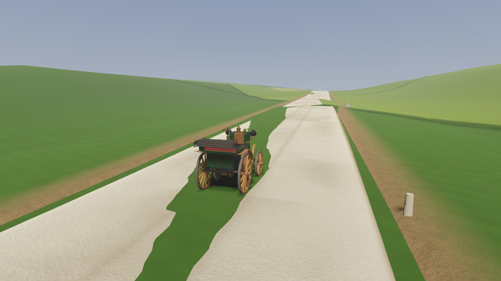 |
| *Cobblestone street of Rolleboise (stage 2). Real screenshot of the development version; provisional terrain, no vegetation.* | *The macadam hill of Rolleboise. Real screenshot of the development version.* |
| 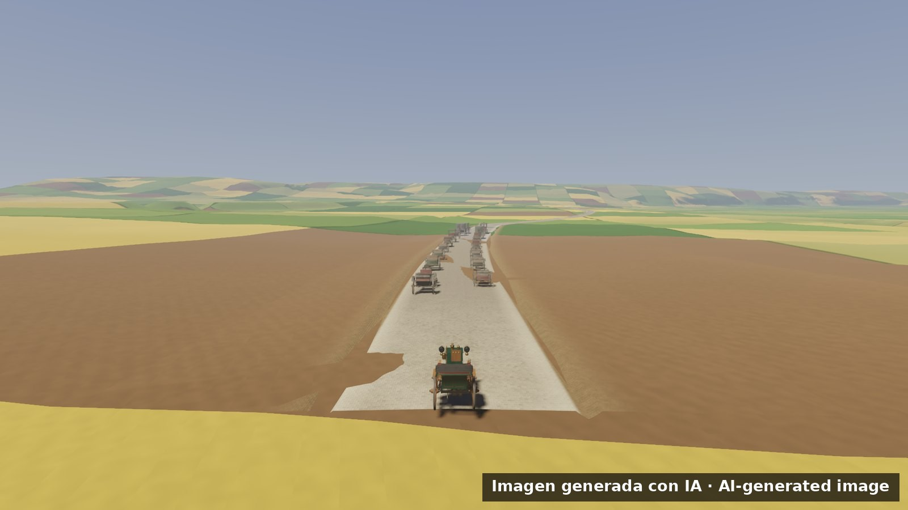 | 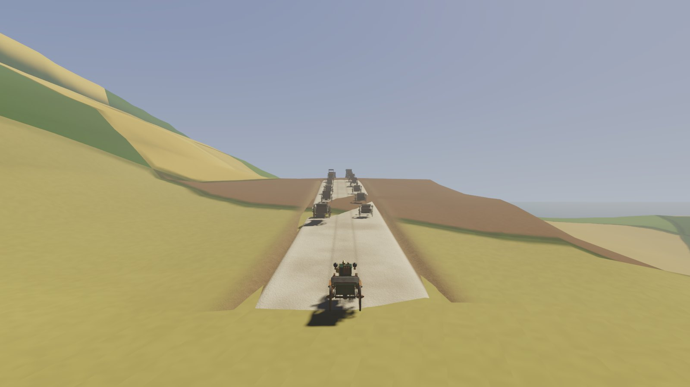 |
| *The start, with the 19 rivals on the grid. Real screenshot of the development version; the rivals' models are based on AI-generated meshes.* | *Grande Corniche, towards La Turbie (1897). Real screenshot of the development version; the rivals' models are based on AI-generated meshes.* |
| 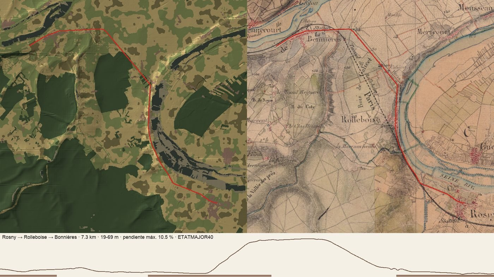 | 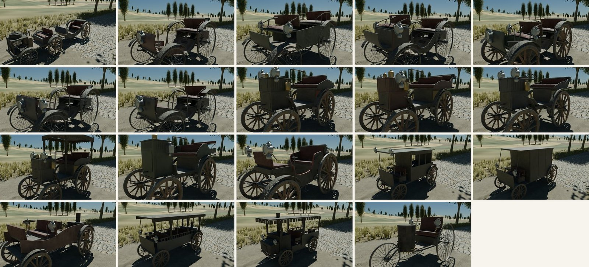 |
| *Stage 2 over the terrain (left) and over the état-major map (right), with its profile. Map generated from IGN data.* | *The 19 rivals of 1894. Render of the 3D models, which are based on AI-generated meshes.* |
| 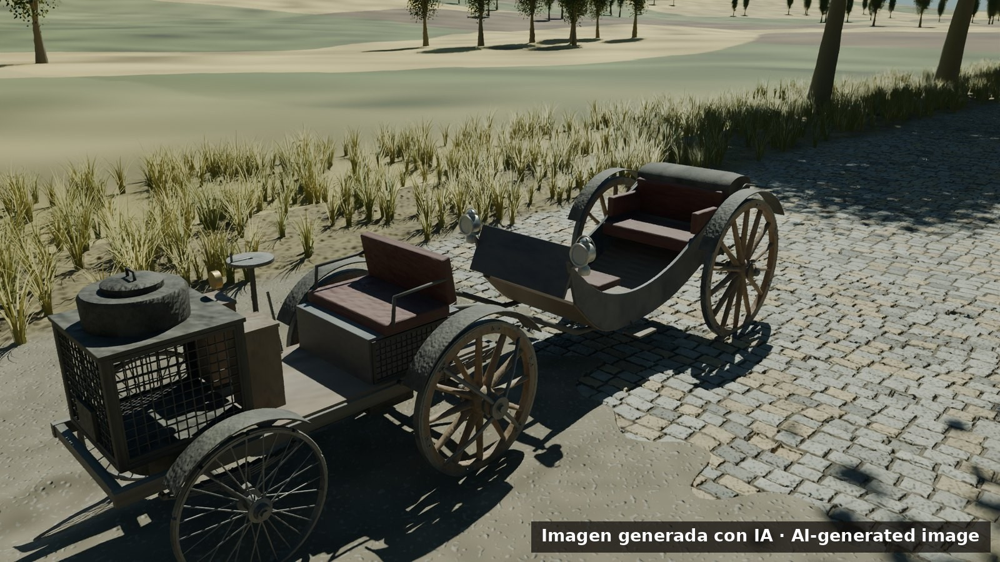 | 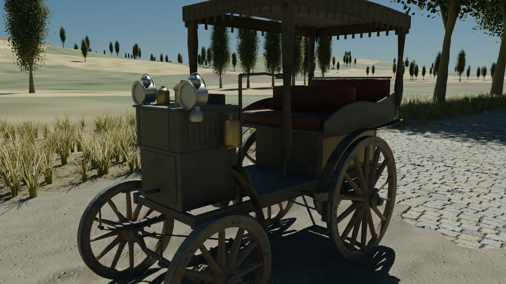 |
| *Steam tractor No. 4 with its victoria. Render of the 3D model, which is based on an AI-generated mesh.* | *No. 64, with awning and fringes. Render of the 3D model, which is based on an AI-generated mesh.* |
| 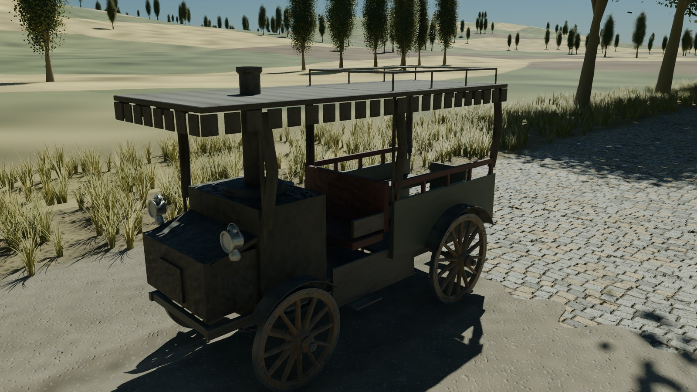 | 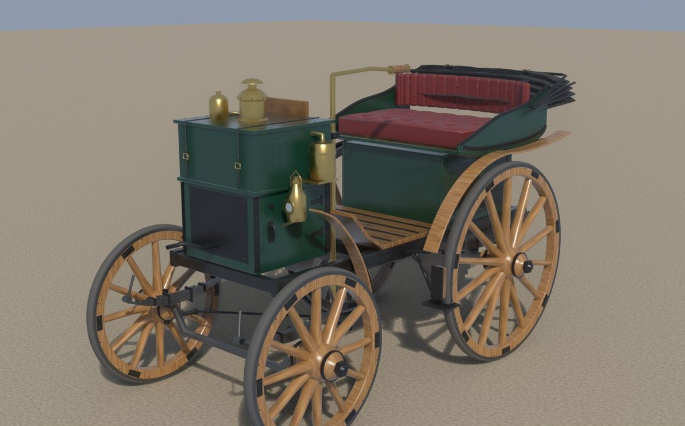 |
| *Steam break-omnibus No. 10. Render of the 3D model, which is based on an AI-generated mesh.* | *Your car, No. 15. Render of the model with materials (studio livery).* |
| 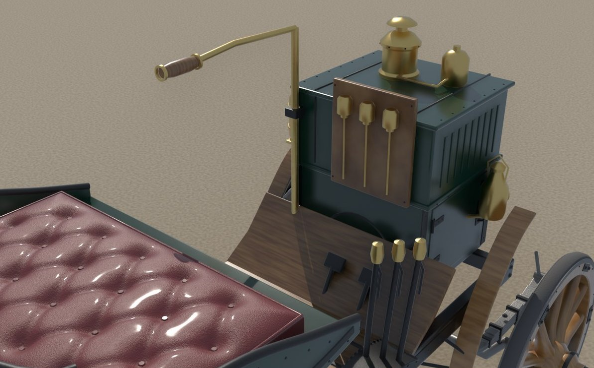 | 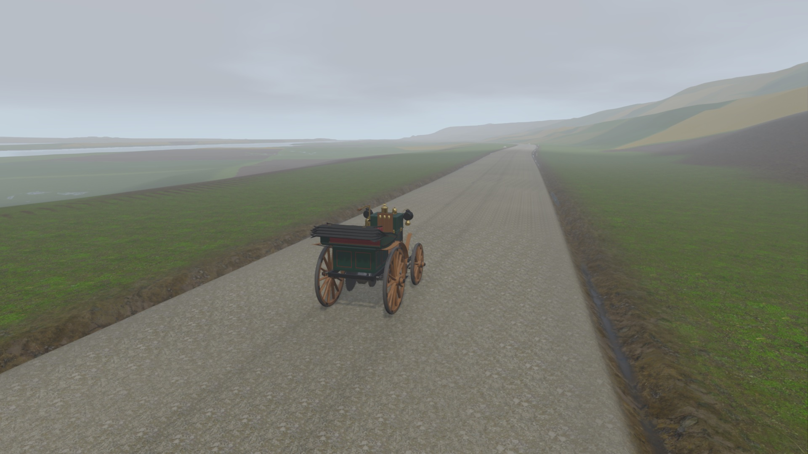 |
| *The driving position: tiller, levers and tufted seat. Render.* | *Morning light with a wet road surface. Real screenshot of the prototype, ultra quality.* |
| 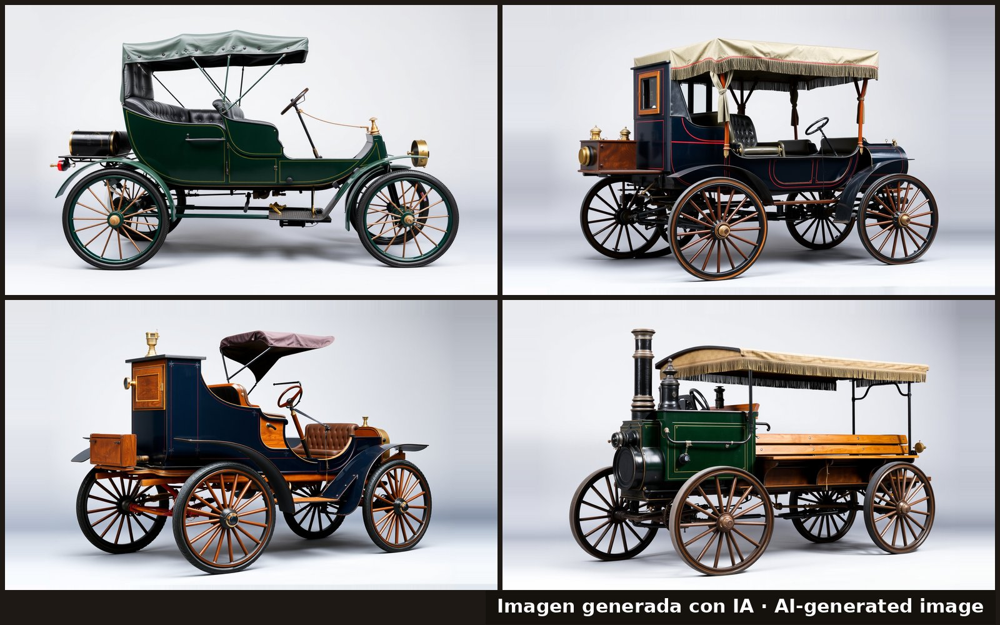 | 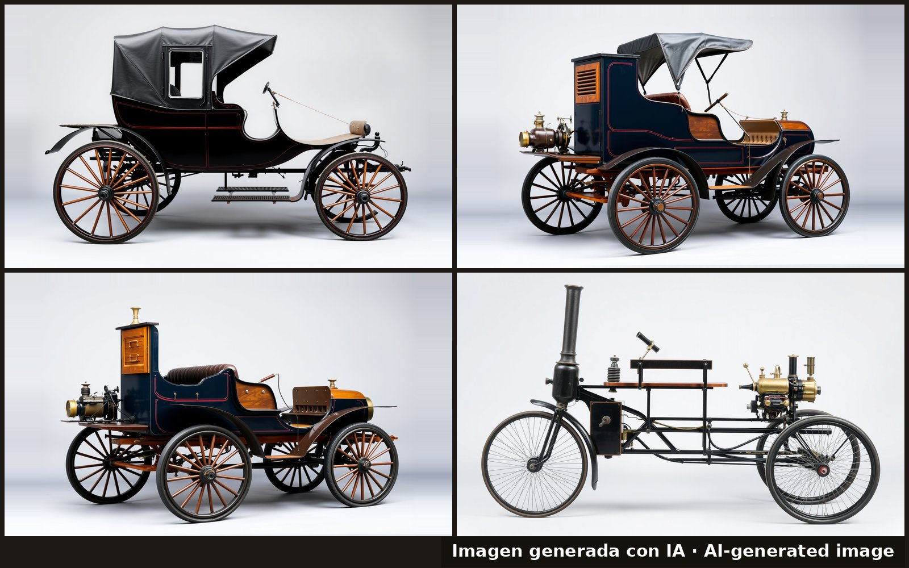 |
| *Concepts of rival vehicles inspired by the 1894 Paris-Rouen race. AI-generated image (FLUX.1 [schnell]); not a game screenshot or a photo of a real vehicle.* | *More concepts of rival vehicles inspired by the 1894 Paris-Rouen race. AI-generated image (FLUX.1 [schnell]); not a game screenshot or a photo of a real vehicle.* |
| 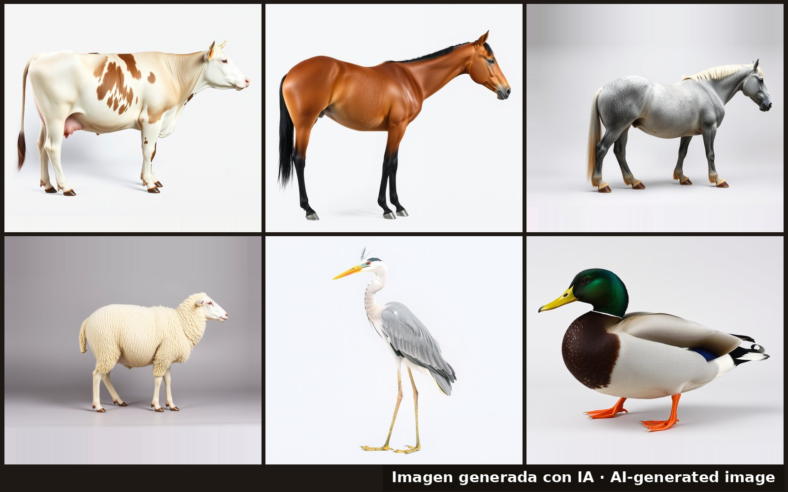 | 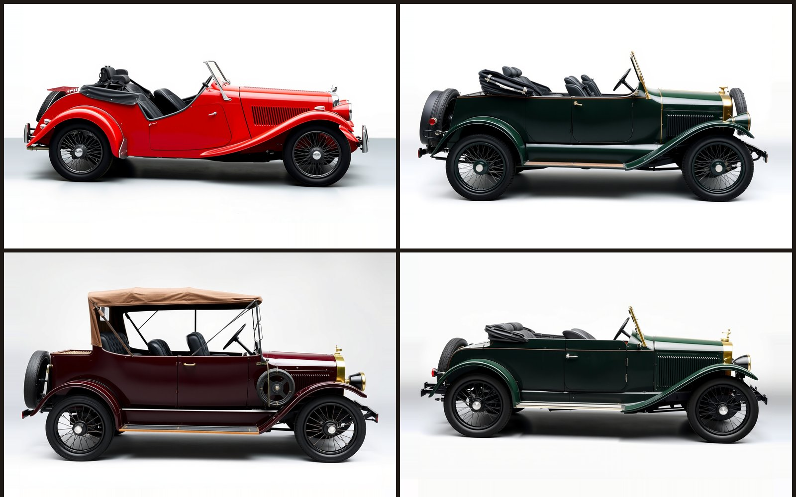 |
| *Normande cow, saddle horse, draught horse, Merino sheep, grey heron and mallard. AI-generated concepts (FLUX.1 [schnell]); not a game screenshot.* | *Concepts of cars from the 1920s and 1930s, for the interwar period. AI-generated image (FLUX.1 [schnell]); not a game screenshot or a photo of a real car.* |
| 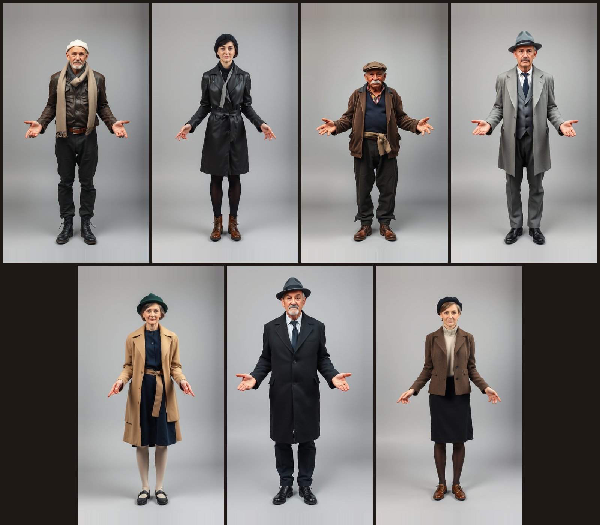 | |
| *Concepts of people from the 1920s and 1930s, seen from the front, in clothes inspired by the period. AI-generated image (FLUX.1 [schnell]); not a game screenshot, and it does not depict real people.* | |

## About the images

- The header **banner** is an **AI-generated image** (FLUX.1 [schnell]).
- **AI-made images:** the banner and the gallery concepts of rivals, wildlife, cars and people, all generated with FLUX.1 [schnell]. Each one carries the mark "Imagen generada con IA · AI-generated image" in a corner. The game screenshots, the 3D model renders and the map are our own work, without generative AI, except for the models of the 1894 rivals, which were modelled using as a reference template meshes generated with TripoSG from FLUX.1 [schnell] images; renders and screenshots in which they appear also carry the mark.
- The **screenshots** are from the prototype in development, without the interface, and do not represent the final quality.
- The **renders** are of the 3D models of the game's cars, still unfinished.
- No image shows brands or logos of real manufacturers.
- **Mapping and terrain:** IGN (Institut national de l'information géographique et forestière, France) – RGE ALTI® (updated 1 October 2026), BD TOPO® (updated 12 November 2026), SCAN État-major® 10K (edition of 12 January 2011) and 40K (edition of 1 October 2011) and BD CARTO® État-major (updated 9 October 2026), according to their metadata records. Original data downloaded from the IGN Géoplateforme (geoservices.ign.fr, data.geopf.fr) between 12 and 15 November 2026 and reused under the [Licence Ouverte Etalab 2.0](https://www.etalab.gouv.fr/licence-ouverte-open-licence/). Derived work: resampled terrain, terrain types and a route returned to 1894.

## Credits and licences

- **Godot Engine**, the game engine (MIT licence).
- **Blender**, for the car models and renders (GPL licence; the models and images produced with Blender are our own).
- **FLUX.1 [schnell]**, by Black Forest Labs, for the AI-generated images (Apache-2.0 licence).
- **TripoSG**, by VAST-AI, for the template meshes of the 1894 rivals (MIT licence).
- **BiRefNet**, to remove the background of the images before generating the meshes (MIT licence).
- **scikit-image**, to extract the mesh surface (BSD-3 licence).
- Data from the French **IGN**, under the Licence Ouverte Etalab 2.0 (see "About the images").

## The studio

**POLVO Y GLORIA** is a project by **[Shania Webstudio](https://shaniawebstudio.com)**, Granada (Spain). Contact: hola@shaniawebstudio.com · [Legal notice (in Spanish)](https://shaniawebstudio.com/aviso-legal)

## Licence

© Shania Webstudio. All rights reserved.
