# POLVO Y GLORIA — juego de carreras históricas en carretera abierta (1894-1970)

> **Juego en desarrollo.** POLVO Y GLORIA todavía no está terminado: las imágenes de esta página son de trabajo y pueden cambiar. *Actualizado el 25 de noviembre de 2026.*

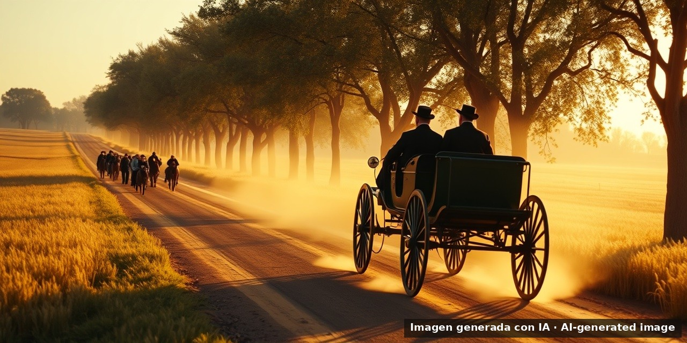

  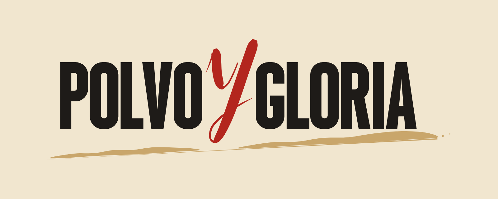

<b>Carreras históricas en carretera abierta, de 1894 a 1970.</b>

<b>Español</b> · <a href="README.en.md">English</a> · Web: <a href="https://lv-webstudio.github.io/polvo-y-gloria-escaparate/">lv-webstudio.github.io/polvo-y-gloria-escaparate</a>

---

## Concepto

Antes de los circuitos, las carreras se corrían por la carretera de todos: entre pueblos, sobre macadán y adoquín, con un mecánico a bordo y una nube de polvo detrás. **POLVO Y GLORIA** te sienta en esos coches, desde los primeros «coches sin caballos» de 1894, sin acelerador y con tres marchas, hasta los últimos grandes maratones de carretera de 1970. Aquí no gana el que más corre, sino el que sabe llevar su máquina hasta la meta: no calar en la cuesta, elegir bien la marcha, cuidar las ruedas y no quedarse sin agua.

Es un juego de **[Shania Webstudio](https://shaniawebstudio.com)** (Granada), hecho con el motor **Godot**. El listón es alto: un acabado visual de gama alta e hiperrealista en un ámbito acotado, con pocas carreras y pocos coches, pero con mucha profundidad.

## Las épocas y la progresión

| Era | Nombre (provisional) | Años |
|---|---|---|
| **I** | Los coches sin caballos | 1894-1903 |
| **II** | Los monstruos de los circuitos | 1904-1914 |
| **III** | Los gigantes de entreguerras | 1919-1940 |
| **IV** | La edad de oro de la carretera | 1947-1957 |
| **V** | Los últimos caminos abiertos (expansión) | 1958-1970 |

Las cuatro primeras eras forman el juego; la quinta está prevista como expansión. Ahora se trabaja en la era I.

**Cómo se avanza** (diseño aprobado, todavía no está en el prototipo):
- Empiezas con un coche de 1894, el n.º 15, y poco dinero, en francos oro de 1894. El dinero se gana conduciendo.
- Los coches se dividen en clases como en 1894: gasolina ligera, gasolina de turismo y vapor. Cada clase tiene su podio y sus premios, además de la clasificación general. Los coches de vapor llegan después de los de gasolina.
- Con lo que ganas compras otros coches de la época. En carrera libre se pueden conducir todos desde el principio.
- El Gran concurso encadena los tres tramos reales de París-Ruan, con los premios de 1894.
- Cada campeonato entrega un coche mítico.
- Los rivales tienen cuatro niveles: Aficionado, Concursante, Constructor y Maestro.

## La primera carrera: París-Ruan, 1894

El 22 de julio de 1894 se corrió el concurso de coches sin caballos de París a Ruan: 126 km, 102 inscritos, 21 coches en la final y 17 llegados a Ruan. El reglamento exigía una media de 12,5 km/h.

En el juego, la carrera se corre en tres tramos de la carretera real:

| Tramo | Recorrido | Largo | Pendiente máxima |
|---|---|---|---|
| 1 | Triel → Vaux → Meulan | 10,1 km | 12,8 % |
| 2 | Rosny → Rolleboise → Bonnières | 7,3 km | 10,5 % |
| 3 | Gaillon → Sainte-Barbe → Vieux-Villez → Heudebouville → Saint-Pierre-du-Vauvray | 13,2 km | 15,0 % |

**Las otras carreras de la era I** (en la versión de desarrollo ya se pueden elegir en el menú, en pruebas):

| Carrera | Tramo | Largo | Pendiente máxima |
|---|---|---|---|
| París-Burdeos 1895 | Versalles → Châteaufort → Saint-Rémy-lès-Chevreuse | 16,0 km | 15,0 % |
| París-Marsella 1896 | Champs-sur-Yonne → Vincelles → Cravant | 11,1 km | 10,3 % |
| Marsella-Niza-La Turbie 1897 | Grande Corniche: col de Villefranche → col d'Èze → La Turbie | 9,5 km | 15,0 % |
| París-Dieppe 1897 | Éragny → Pontoise → Ennery | 7,2 km | 15,0 % |
| París-Trouville 1897 | Bajada de La Rivière-Thibouville | 13,4 km | 14,0 % |
| Vuelta de 1899 | Orgeval → Chambourcy → Saint-Germain (route des Quarante-Sous) | 6,2 km | 10,5 % |
| París-Berlín 1901 | Douzy → Sachy → Carignan | 11,0 km | 6,7 % |
| París-Madrid 1903 | Châteaudun → Cloyes | 9,1 km | 8,4 % |

Las pendientes de la carretera se limitan al 15 %, porque el relieve de 10 m mete los taludes en las carreteras de ladera.

## Los coches de 1894

**Tu coche: el n.º 15.**
- Biplaza de motor delantero, sin acelerador: el motor va a régimen fijo.
- Tres marchas, una cadena al eje trasero y caña de dirección.
- Llanta de hierro o de goma maciza, a elegir.
- Su peso y su potencia en la simulación son provisionales, sacados de las fuentes de la época, y se ajustarán si aparecen datos mejores.

**Los 19 rivales de París-Ruan.** Cada uno está modelado a partir de los grabados y las fotos de la prueba, con el dorsal que llevó en 1894:
- n.º 4, tractor de vapor con victoria;
- biplaza (n.º 27), break (n.º 31), fiacre (n.º 30), phaéton (n.º 65) y dos vis-à-vis (n.º 28 y n.º 42), todos sobre un bastidor de tubo con motor trasero;
- dos-à-dos (n.º 13), cuatro plazas de nuevo tipo (n.º 14), biplaza con volante (n.º 24), cuatro plazas con toldo y flecos (n.º 64) y cuatro plazas de motor delantero (n.º 7);
- victoria de motor trasero (n.º 85);
- ómnibus cerrado de 6 plazas (n.º 18), furgón de reparto (n.º 19), coche ligero calentado al petróleo (n.º 44) y breack de 9 plazas (n.º 60);
- break-ómnibus de vapor (n.º 10);
- triciclo (n.º 61).

Los coches están inspirados en los de la prueba, sin nombres de marca. En la versión de desarrollo, los 19 esperan en la parrilla de salida; que conduzcan en el tramo es el siguiente paso.

## Conducción y simulación

- **Simulación propia** de cada coche: motor a régimen fijo, embrague que patina, tres marchas, inversor (adelante, punto muerto y atrás), caña de dirección y freno.
- **Firme:** adoquín, macadán bueno y camino malo, con sus baches. Cada uno se nota en el agarre y en las sacudidas.
- **Encender:** el motor se arranca con manivela. Si sale con mala marcha o de golpe, da tirones y puede apagar el quemador, que se vuelve a encender con el coche parado.
- **Averías:** ruedas que se rompen y se cambian por el camino, ballestas que ceden, y el motor que se cala si no se cuida el embrague.
- **Mandos:** teclado o mando. El menú tiene una guía, «Cómo se conduce».

## Mapas reales: la cuesta de Rolleboise

Los tramos salen de los datos abiertos del IGN de Francia:
- el relieve real a 10 m;
- el eje de la antigua carretera nacional, que hoy lleva otro número;
- las cartas del état-major de 1820-1866, de las que salen los pueblos, el agua y el bosque de la época.

El generador convierte la carretera de 2026 en la de 1894.

En el tramo 2, entre Rosny y Bonnières, las travesías de Rolleboise y Bonnières son de **adoquín**. La cuesta de Rolleboise, con rampas del 5 al 7 %, es de **macadán**. El tipo de firme está deducido de la práctica de la época, no documentado tramo a tramo.

## Rigor histórico

- Coches, carreteras y pruebas documentados con fuentes de la época siempre que se puede: revistas y periódicos de 1894, grabados y fotos de la prueba, y las cartas del état-major.
- Los coches están **inspirados en** modelos reales, con nombres y detalles propios y sin marcas. En el taller solo hay las piezas que existían en cada época.
- Lo que las fuentes no dicen se marca como estimación, en los datos y en la pantalla del prototipo (por ejemplo, el agarre de la llanta de goma).
- **Las carreras de la memoria:** algunas carreras históricas acabaron en tragedia. Se abren al completar el juego y se tratan con respeto: el accidente real nunca se recrea, no hay celebración ni recompensas que se vendan, y una pantalla documental separa los hechos de la ficción.

## Tecnología

- **Godot 4.7** (.NET). La simulación del coche está en C# y el juego, en GDScript.
- **Blender por código:** cada coche se construye con un guion de Python (bastidor, ruedas, ballestas, faroles, bancos), con materiales, niveles de detalle y colisiones.
- **Mapas por código:** un generador en Python lee los datos del IGN y saca el relieve, los tipos de terreno y el eje de cada tramo.
- **Pruebas automáticas:** comprueban en cada cambio que la simulación da lo mismo dentro y fuera de Godot, además de los menús, los mandos, el firme y las averías.

## Estado y hoja de ruta

**En desarrollo, prototipo.** Ya se conduce el coche de 1894 por los tramos reales, con su física, sus marchas y sus averías. Gráficos, terreno, sonido y contenido son provisionales y van a cambiar: en los tramos todavía no hay vegetación ni pueblos. No hay fecha de lanzamiento.

Lo que viene, en este orden y **sin fechas prometidas**:

1. Rivales que conducen el tramo con la misma física que tú, salen cada 30 segundos como en 1894 y más adelante se adelantan.
2. Vegetación, pueblos y cielo en los tramos.
3. La trayectoria: dinero, cochera, el Gran concurso y los coches míticos.
4. El Museo: ver los coches en alta calidad, abrirlos, arrancarlos, oírlos y montarse, con su foto y su historia.
5. La cabina y los tres niveles de manejo.
6. Las eras II a IV y, después, la expansión de la era V.

## En preparación

- **Fauna del valle del Sena.** El primer tramo, en el valle del Sena en julio de 1894, tendrá los animales de la zona y de la época: vacas normandas, caballos de tiro y de silla, ovejas merinas, gallinas de Houdan y aves del río, como la garza real y el ánade real.
- **Los rivales de 1894, en concepto.** Conceptos de los vehículos rivales, inspirados en la carrera París-Ruan de 1894: coches de gasolina y de vapor, con toldo, con capota o descubiertos, y un triciclo.
- **La época de entreguerras.** Se prepara ya otra época, la de los años 20 y 30, con sus coches y su gente: biplazas deportivos, turismos descubiertos y la ropa de la calle de entonces.

## Galería

| | |
|---|---|
| 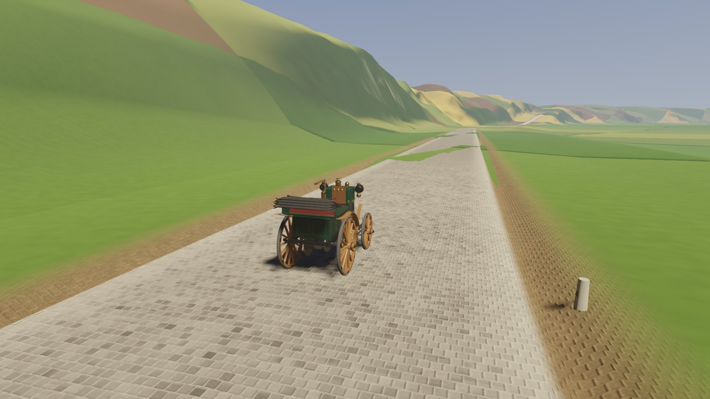 | 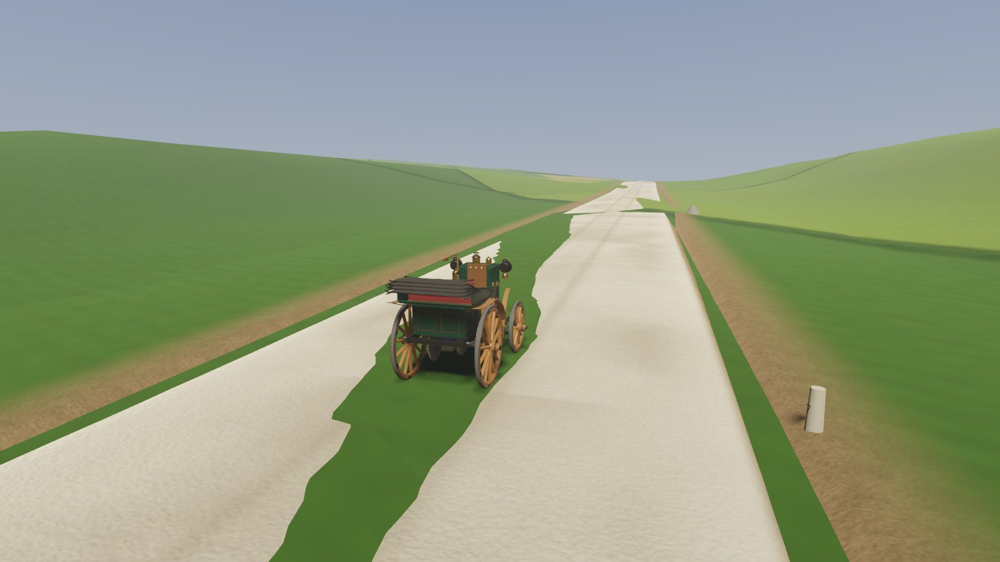 |
| *Travesía de adoquín de Rolleboise (tramo 2). Captura real de la versión de desarrollo; terreno provisional, sin vegetación.* | *La cuesta de macadán de Rolleboise. Captura real de la versión de desarrollo.* |
| 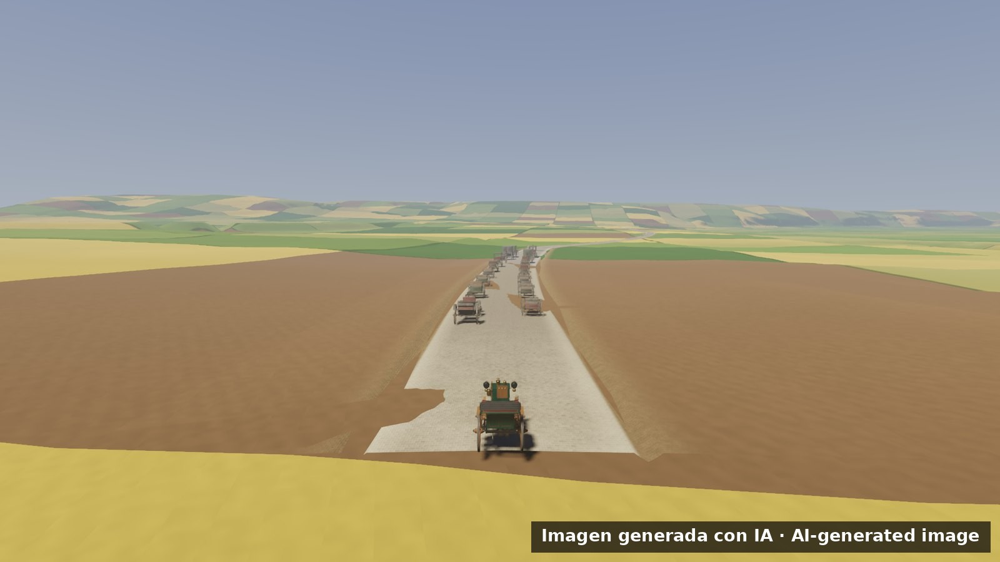 | 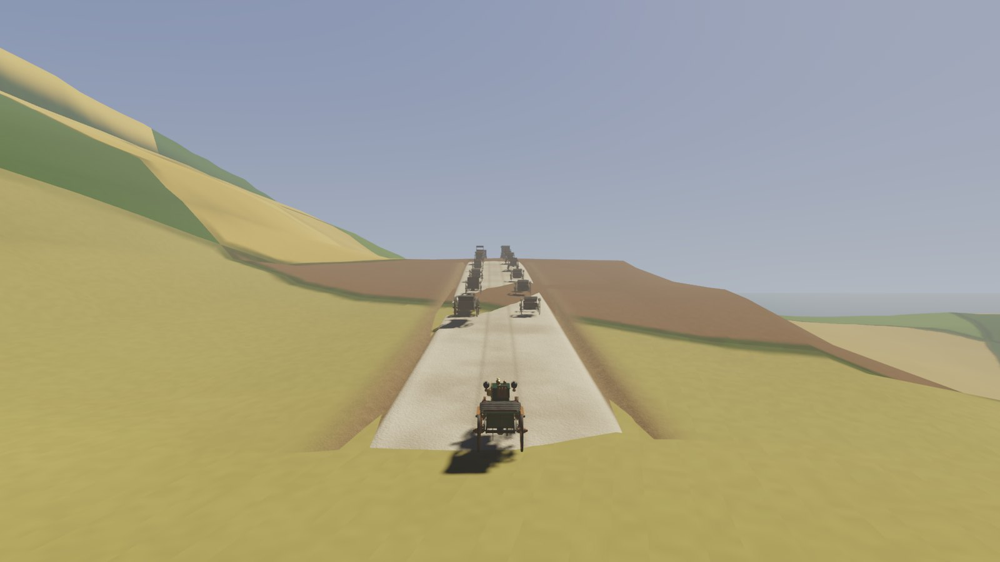 |
| *La salida, con los 19 rivales en la parrilla. Captura real de la versión de desarrollo.* | *Grande Corniche, hacia La Turbie (1897). Captura real de la versión de desarrollo.* |
| 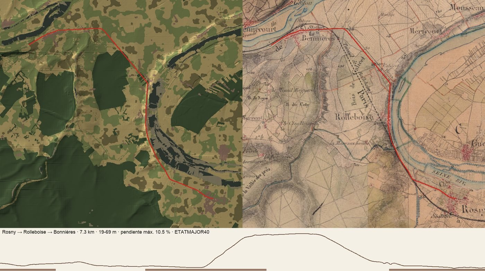 | 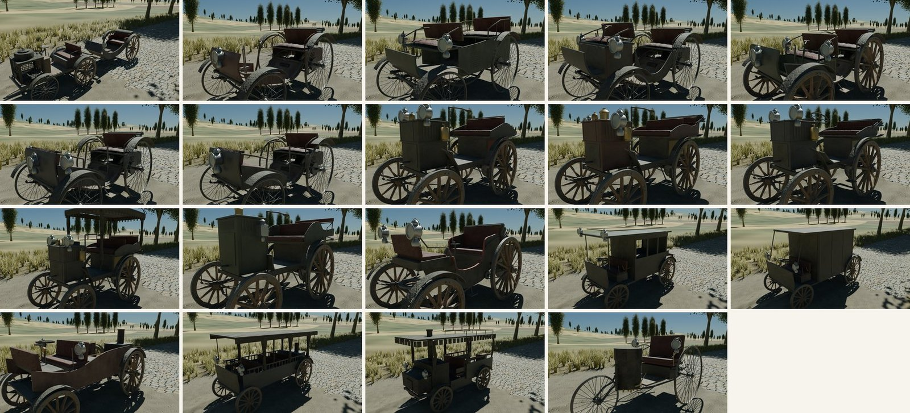 |
| *El tramo 2 sobre el relieve (izquierda) y sobre la carta del état-major (derecha), con su perfil. Mapa generado con datos del IGN.* | *Los 19 rivales de 1894. Render del modelo 3D.* |
| 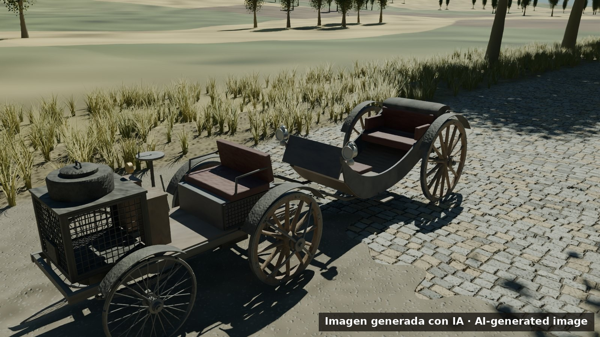 | 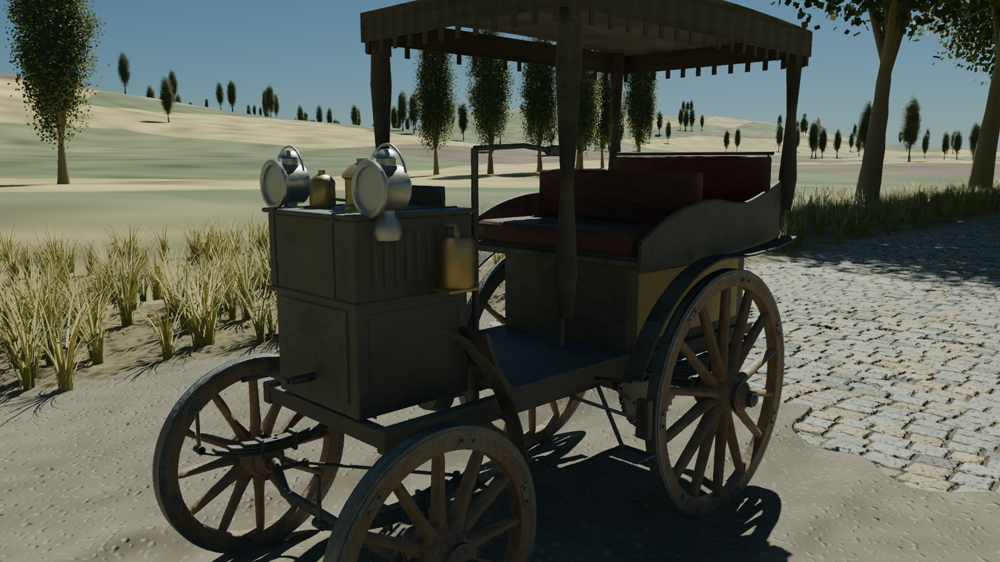 |
| *El tractor de vapor n.º 4 con su victoria. Render del modelo 3D.* | *El n.º 64, con toldo y flecos. Render del modelo 3D.* |
| 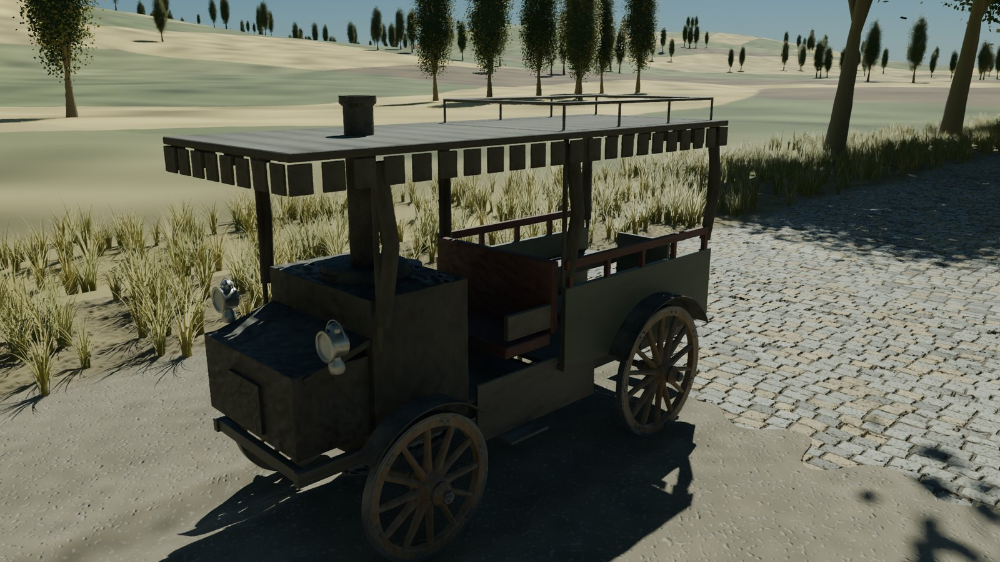 | 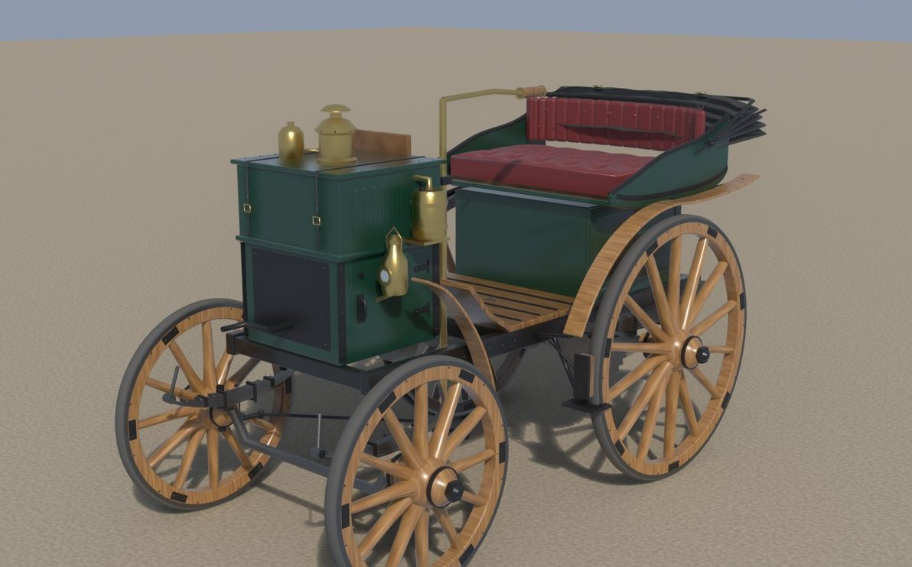 |
| *El break-ómnibus de vapor n.º 10. Render del modelo 3D.* | *Tu coche, el n.º 15. Render del modelo con materiales (librea en estudio).* |
| 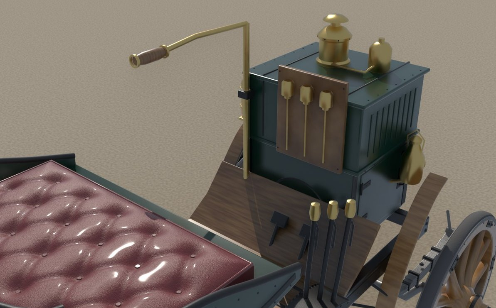 | 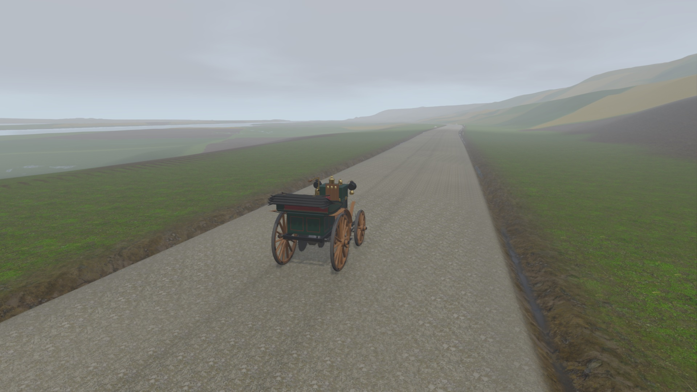 |
| *El puesto de conducción: caña de dirección, palancas y asiento capitoné. Render.* | *Luz de mañana con el firme mojado. Captura real del prototipo, calidad ultra.* |
| 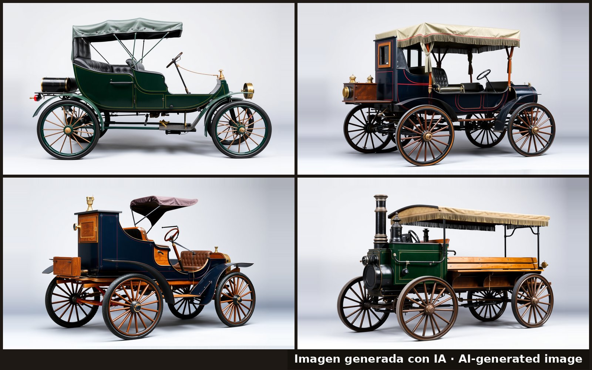 | 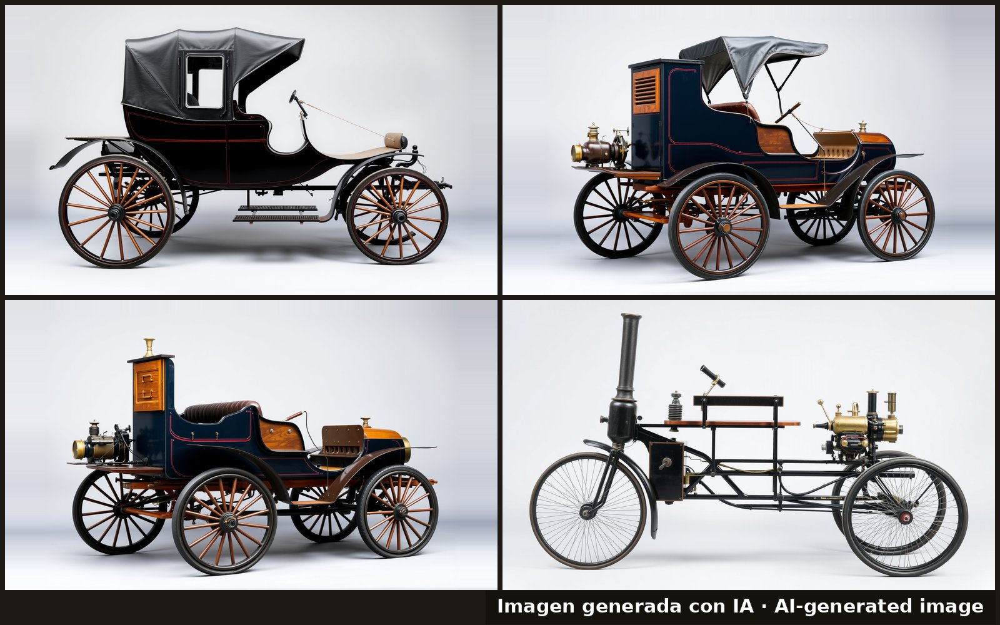 |
| *Conceptos de vehículos rivales inspirados en la carrera París-Ruan de 1894. Imagen generada con IA (FLUX.1 [schnell]); no es una captura del juego.* | *Más conceptos de vehículos rivales inspirados en la carrera París-Ruan de 1894. Imagen generada con IA (FLUX.1 [schnell]).* |
| 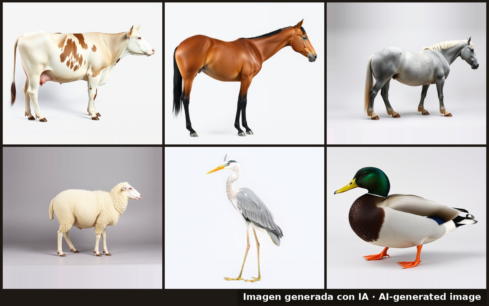 | 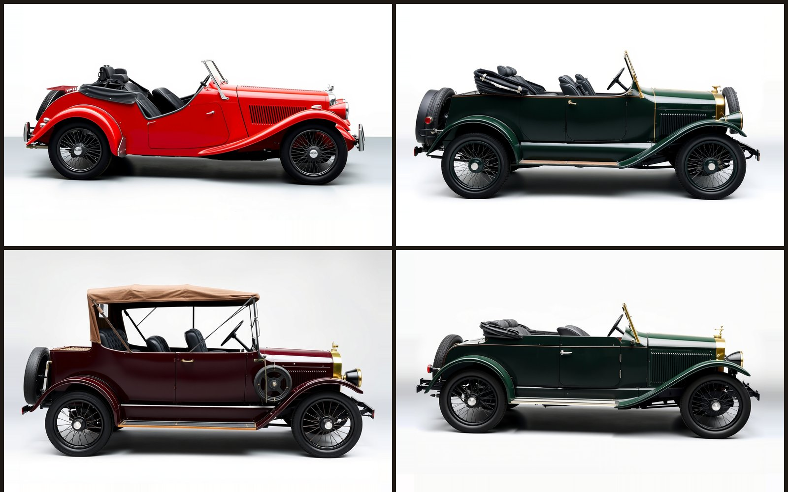 |
| *Vaca normanda, caballo de silla, caballo de tiro, oveja merina, garza real y ánade real. Conceptos generados con IA (FLUX.1 [schnell]).* | *Conceptos de coches de los años 20 y 30, para la época de entreguerras. Imagen generada con IA (FLUX.1 [schnell]).* |
| 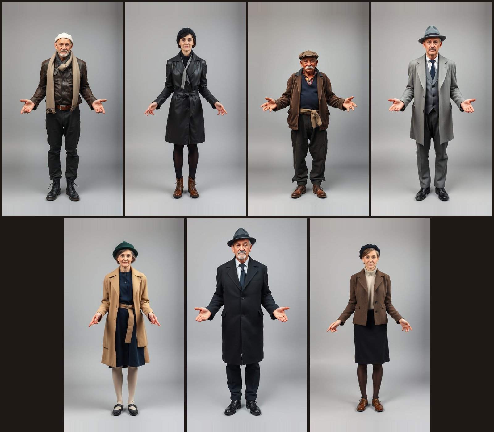 | |
| *Conceptos de personas de los años 20 y 30, de frente, con la ropa de la época. Imagen generada con IA (FLUX.1 [schnell]); no son personas reales.* | |

## Sobre las imágenes

- El **banner** de cabecera es una **imagen generada con IA** (FLUX.1 [schnell]).
- **Imágenes hechas con IA:** el banner y los conceptos de rivales, fauna, coches y personas de la galería, todos generados con FLUX.1 [schnell]. Cada una lleva en una esquina la marca «Imagen generada con IA · AI-generated image». Las capturas, los renders y el mapa no están generados con IA.
- Las **capturas** son del prototipo en desarrollo, sin la interfaz, y no representan la calidad final.
- Los **renders** son de los modelos 3D de los coches del juego, todavía sin terminar.
- Ninguna imagen muestra marcas ni logotipos de fabricantes reales.
- **Cartografía y relieve:** © IGN – RGE ALTI®, BD TOPO®, SCAN État-major® 10K y 40K y BD CARTO® État-major, bajo la Licence Ouverte Etalab 2.0. Datos consultados entre el 12 y el 15 de noviembre de 2026. Es obra derivada: relieve remuestreado, tipos de terreno y trazado devuelto a 1894.

## Créditos y licencias

- **Godot Engine**, el motor del juego (licencia MIT).
- **Blender**, para los modelos y los renders de los coches (licencia GPL; los modelos y las imágenes que salen de Blender son nuestros).
- **FLUX.1 [schnell]**, de Black Forest Labs, para las imágenes generadas con IA (licencia Apache-2.0).
- Datos del **IGN** de Francia, bajo la Licence Ouverte Etalab 2.0 (ver «Sobre las imágenes»).

## El estudio

**POLVO Y GLORIA** es un proyecto de **[Shania Webstudio](https://shaniawebstudio.com)**, Granada (España). Contacto: hola@shaniawebstudio.com

## Licencia

© Shania Webstudio. Todos los derechos reservados.
