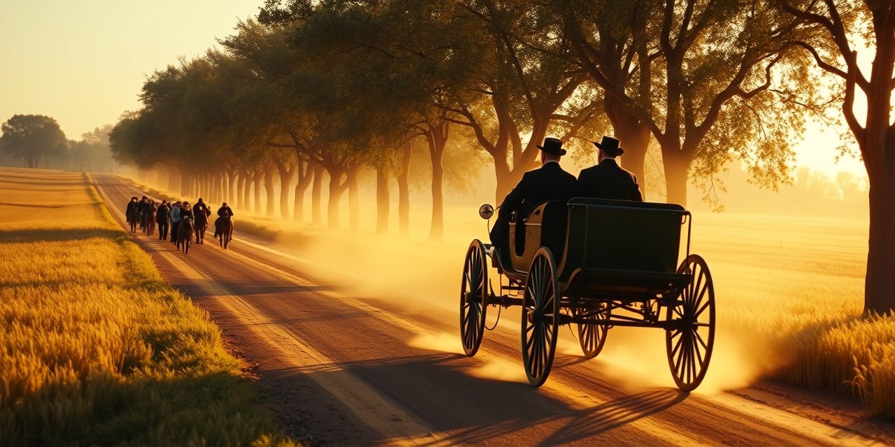

  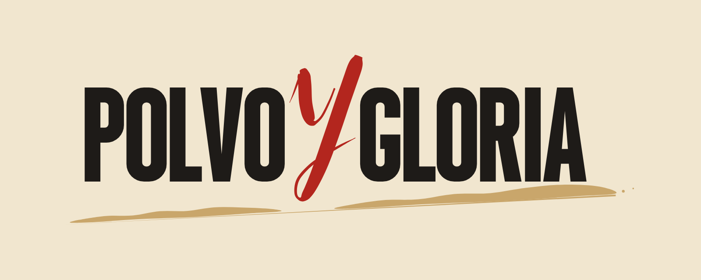

<b>Carreras históricas en carretera abierta, de 1894 a 1970.</b>

---

Antes de los circuitos, las carreras se corrían por la carretera de todos: entre pueblos, sobre macadán y adoquín, con un mecánico a bordo y una nube de polvo detrás. **POLVO Y GLORIA** te sienta en esos coches, desde los primeros «coches sin caballos» de 1894, sin acelerador y con tres marchas, hasta los últimos grandes maratones de carretera de 1970. Aquí no gana el que más corre, sino el que sabe llevar su máquina hasta la meta: no calar en la cuesta, elegir bien la marcha, cuidar las ruedas y no quedarse sin agua.

Es un juego de **Shania Webstudio**, hecho con el motor **Godot**, con un listón alto: acabado visual de gama alta e hiperrealista en un ámbito acotado, con pocas carreras y pocos coches, pero con mucha profundidad.

## Las eras

| Era | Nombre (provisional) | Años |
|---|---|---|
| **I** | Los coches sin caballos | 1894-1903 |
| **II** | Los monstruos de los circuitos | 1904-1914 |
| **III** | Los gigantes de entreguerras | 1919-1940 |
| **IV** | La edad de oro de la carretera | 1947-1957 |
| **V** | Los últimos caminos abiertos (expansión) | 1958-1970 |

Las cuatro primeras eras forman el juego; la quinta está prevista como expansión.

## Lo que lo hace distinto

- **Carretera abierta.** Se corre por carreteras y circuitos de carretera, cerrados para la carrera, como se hacía entonces. Los primeros tramos son los de la carretera real de París a Ruan de 1894, a escala 1:1 y con el relieve del terreno.
- **Física de coches de época.** Cada coche se simula con sus datos: peso, motor, marchas, embrague, frenos, tipo de llanta y firme. El coche de 1894 va a régimen fijo y con tres marchas, y una cuesta puede ser más que suficiente para pararlo.
- **Daños y averías.** Ruedas que se rompen, ballestas que ceden, quemadores que se apagan. Hay que reparar por el camino.
- **Consumo.** Gasolina y agua se gastan por el camino (el coche de 1894 pierde agua cada hora) y hay que contar con ello.
- **Rivales con la misma física.** Los rivales conducen con las mismas reglas que tú, sin trampas: su dificultad sale de cómo conducen y de cómo cuidan la mecánica, no de ventajas ocultas.
- **Cabina y niveles de manejo** (en diseño). Una vista desde el asiento con los mandos de verdad, y tres niveles de manejo, desde la experiencia de época completa hasta una asistida, sin tocar la física.
- **Rigor histórico.** Coches, carreteras y pruebas documentados con fuentes, de época siempre que se puede. Los coches están *inspirados en* modelos reales, con nombres y detalles propios y sin marcas, y las piezas del taller son solo las que existían en cada época.
- **Las carreras de la memoria.** Algunas carreras históricas acabaron en tragedia. Se abren al completar el juego y se tratan con respeto: el accidente real nunca se recrea, no hay celebración ni recompensas que se vendan, y una pantalla documental separa los hechos de la ficción.

## Galería

| | |
|---|---|
| 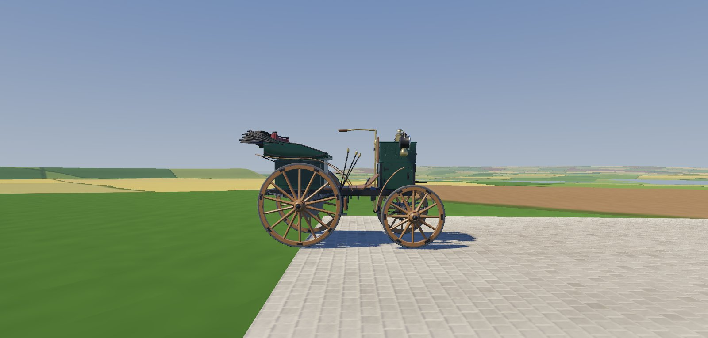 | 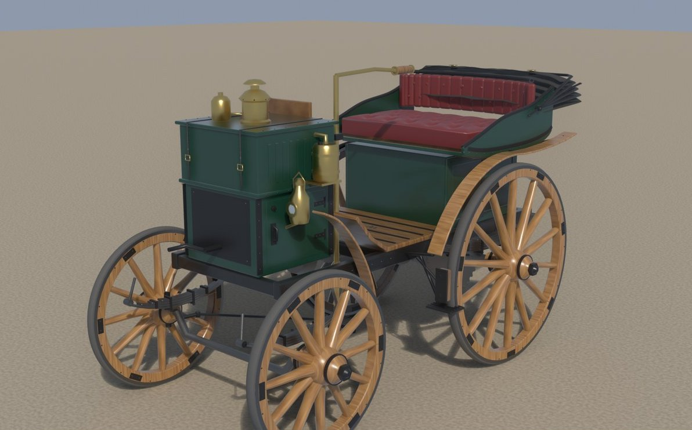 |
| *Prototipo: el coche n.º 15 de 1894 en un tramo real (terreno y firme provisionales).* | *Coche n.º 15 de 1894: render del modelo con materiales (librea en estudio).* |
| 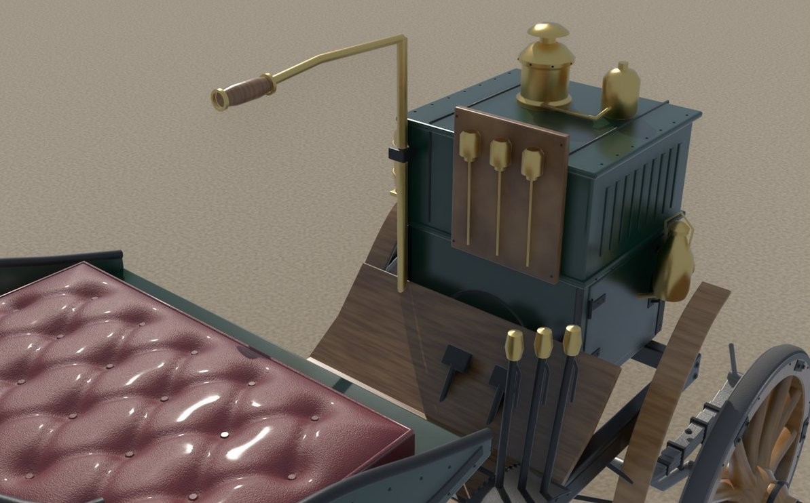 | 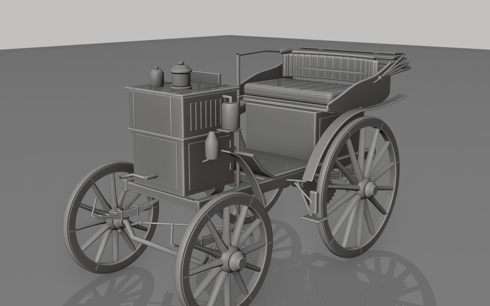 |
| *El puesto de conducción: caña de dirección, palancas y asiento capitoné.* | *El modelo de alta definición, en gris, con sus piezas mecánicas.* |
| 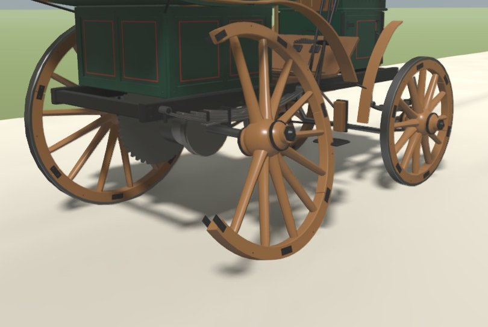 | |
| *Prototipo: una rueda rota en la pista de pruebas.* | |
| 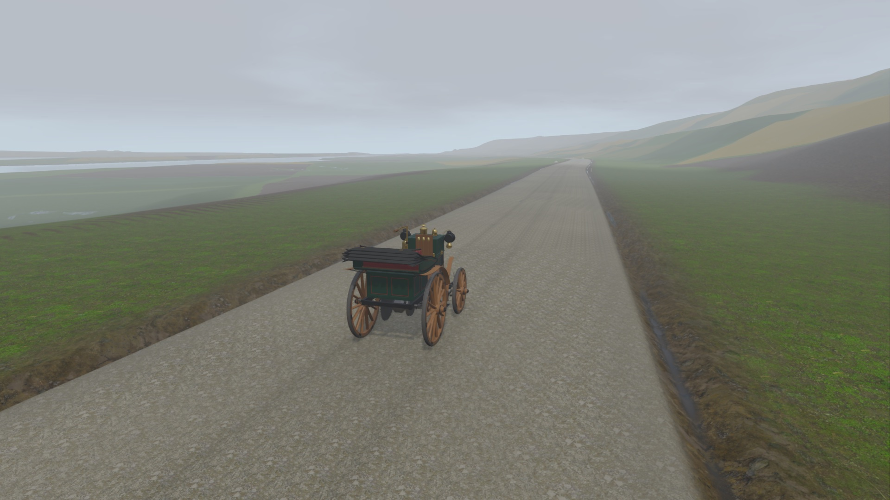 | 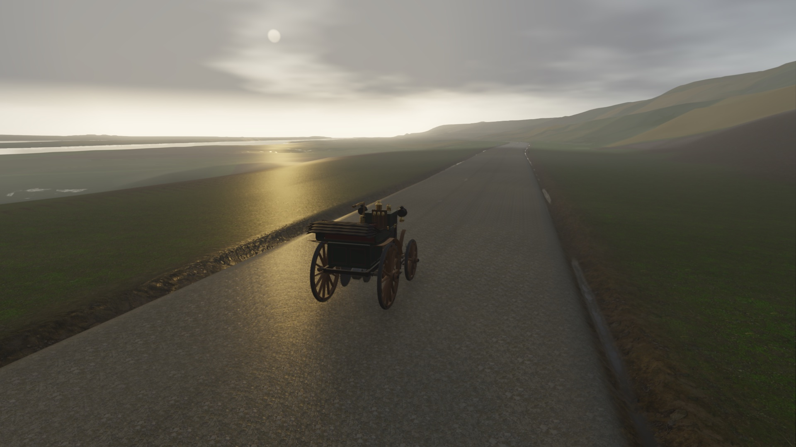 |
| *Prototipo: luz de mañana con el firme mojado (calidad ultra).* | *Prototipo: atardecer nublado con el firme mojado (calidad ultra).* |
| 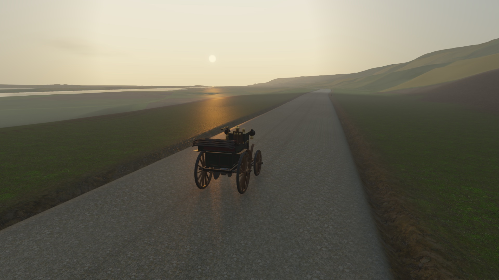 | 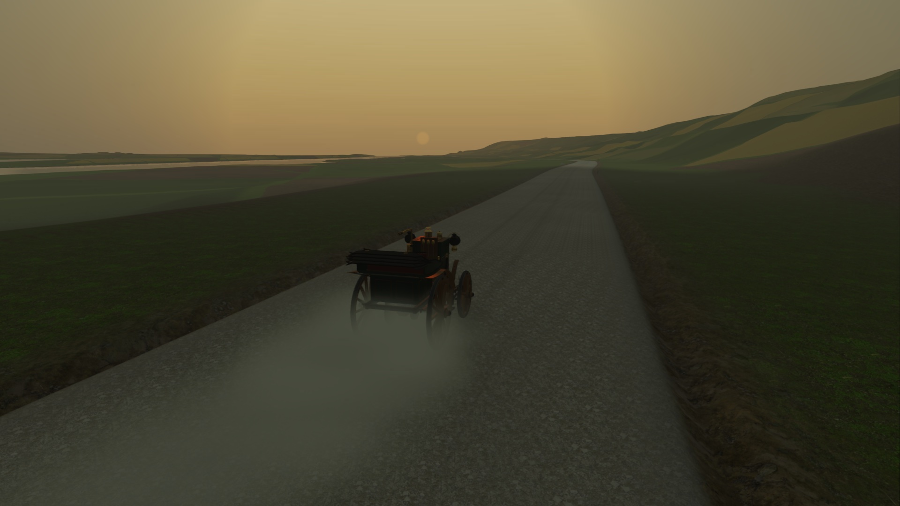 |
| *Prototipo: atardecer despejado con el firme mojado (calidad ultra).* | *Prototipo: puesta de sol con el firme seco (calidad ultra).* |

Web: https://lv-webstudio.github.io/polvo-y-gloria-escaparate/

## Estado

**En desarrollo, prototipo.** Ya se conduce el primer coche de 1894 sobre un tramo real, con su física, sus marchas y sus averías. Gráficos, terreno, sonido y contenido son provisionales y van a cambiar. No hay fecha de lanzamiento.

## El estudio

**POLVO Y GLORIA** es un proyecto de **Shania Webstudio**.

## Sobre las imágenes

- El **banner** de cabecera es una **imagen generada con IA** (FLUX.1-schnell).
- Las **capturas** son del **prototipo** en desarrollo y no representan la calidad final.
- Los **renders** son del modelo 3D del coche del juego, todavía sin terminar.
- Ninguna imagen muestra marcas ni logotipos de fabricantes reales.

## Licencia

© Shania Webstudio. Todos los derechos reservados.

---

### In English

**POLVO Y GLORIA** is a historical open-road racing game spanning 1894 to 1970, made by **Shania Webstudio** with the Godot engine. It covers five eras: I, 1894-1903; II, 1904-1914; III, 1919-1940; IV, 1947-1957; and V, 1958-1970, which is planned as an expansion. Races are held on real roads, with physics for each period car, damage and breakdowns, fuel and water consumption, and rivals that follow the same physics as the player. A cockpit view with three handling levels is being designed. Cars are inspired by real models but carry no real brands. Historic races that ended in tragedy unlock only after the game is completed and are treated with respect: the real accident is never recreated. The game is **in development, at prototype stage**, and has no release date. The banner is AI-generated; screenshots come from the prototype. © Shania Webstudio. All rights reserved.
